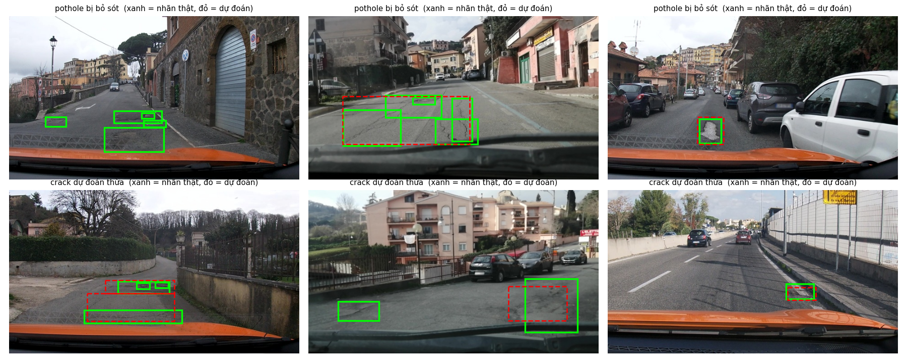

Họ tên: Đồng Mạnh Hùng
`dataset_version`: d10-21e4070301

## Bảng tổng hợp (số của bạn, lấy từ `report/evidence/*.json`)

| Mã | Setup | Tham số huấn luyện | VRAM đỉnh (GB) | Phút | F1 | CI95 | FP/ảnh | F1 pothole | F1 crack | F1 manhole |
|---|---|---|---|---|---|---|---|---|---|---|
| E0 | zero-shot | 0 | – | – | 0.090 | 0.064–0.119 | 0.94 | 0.135 | 0.024 | 0.193 |
| E1 | LoRA LLM | 33,030,144 | 6.89 | 41.4 | 0.266 | 0.230–0.305 | 1.21 | 0.168 | 0.196 | 0.522 |
| E2 | + projector | 142,135,296 | 8.71 | 42.1 | 0.309 | 0.271–0.351 | 1.15 | 0.171 | 0.239 | 0.585 |
| E3 | + LoRA ViT | 148,426,752 | 8.90 | 52.1 | 0.437 | 0.395–0.483 | 0.86 | 0.238 | 0.363 | 0.711 |
| E4 | E3 với `data_size` = 10% (142 ảnh), 300 bước | 148,426,752 | 8.65 | 51.8 | 0.269 | 0.237–0.302 | 1.71 | 0.176 | 0.195 | 0.536 |

Ghi chú: một lần chạy (seed 42) trên tập test 311 ảnh; `VRAM đỉnh` và `Phút` lấy từ `ckpt/*/run.json`. các thí nghiệm được chạy song song trên 2 GPU T4 của Kaggle (mỗi job một GPU, dùng chung CPU), nên thời gian có thể lệch so với khi chạy riêng lẻ. E4 đổi biến `data_size` (10% so với 100%); mốc 100% chính là E3.

## 10 câu hỏi (trả lời bằng **số của bạn**, không chép lại tài liệu)
### Câu 1 — Kiến trúc: ViT, projector và LLM của Qwen3-VL-4B có bao nhiêu tham số mỗi khối, và E1/E2/E3 mỗi cái cập nhật khối nào?
Qwen3-VL-4B có tổng ≈ 4,44B tham số: phần LLM (kèm embedding) ≈ 4,0B, ViT ≈ 415M, trong đó `visual.merger` ≈ 27M và `visual.deepstack_merger_list` ≈ 82M (các con số này theo mô tả của đề; số tham số mình tự đo từ các lần chạy nằm ngay dưới).

- **E1** chỉ cập nhật LLM bằng LoRA rank 16 trên 252 module (36 lớp × 7 module: q/k/v/o và gate/up/down), tổng **33,030,144** tham số huấn luyện. ViT và projector đóng băng.
- **E2** = E1 + mở đầy đủ projector: tham số huấn luyện tăng lên 142,135,296, tức thêm **109,105,152** (khớp 27M + 82M ≈ 109M), vẫn 252 module LoRA.
- **E3** = E2 + LoRA trên ViT: thêm 96 module (24 khối × 4: `attn.qkv`, `attn.proj`, `mlp.linear_fc1`, `mlp.linear_fc2`), tức 348 module, thêm **6,291,456** tham số (= 24 khối × 262,144), tổng 148,426,752.

Vậy dù E2 huấn luyện nhiều hơn E1 gấp ~4,3 lần số tham số, E3 chỉ thêm 4% so với E2 mà là bước tăng F1 lớn nhất (xem câu 7).

### Câu 2 — E0: `parse_valid_rate` bằng bao nhiêu, và hai lỗi phổ biến nhất của model gốc là gì (kèm một ví dụ output thô)?
`parse_valid_rate` của E0 = **0,952** (296/311 ảnh parse được; 15 ảnh không parse được). F1 chỉ 0,090 (P = 0,123, R = 0,070).

Hai lỗi phổ biến nhất, rút ra từ `work/e0.jsonl` và `e0.json`:

1. **Lặp vô hạn rồi bị cắt cụt, JSON hỏng.** 14 trong 15 ảnh lỗi không kết thúc bằng `]`: model liệt kê liên tục các box cùng nhãn, toạ độ dịch dần từng bước (8 ảnh lặp `crack`, 5 ảnh lặp `pothole`, 1 ảnh lẫn cả hai), cho tới khi hết `max_new_tokens=256`; ảnh còn lại kết thúc bằng `]` nhưng JSON vẫn sai cú pháp. Ví dụ (rút gọn): `[{"label": "crack", "bbox_2d": [650, 536, 714, 567]}, {"label": "crack", "bbox_2d": [739, 470, 792, 490]}, ... {"label": "crack", "bbox_2d": [620, 625, ` (kết thúc giữa chừng).
2. **Bịa crack và bỏ sót pothole/manhole.** Model dự đoán 201 box `crack` nhưng chỉ 6 đúng (precision 0,030, F1 crack 0,024, 195 FP); recall pothole 0,099 và manhole 0,141. Ngoài ra 32 ảnh bị trả về `[]`. Ví dụ một output hợp lệ của E0: `[{"label": "crack", "bbox_2d": [750, 634, 850, 684]}]`.

Điểm đáng chú ý: model gốc tuân đúng định dạng và thang 0–1000 của prompt (không box nào có toạ độ > 1000), nên vấn đề của E0 nằm ở **định vị và phân loại**, không phải định dạng.

### Câu 3 — Thang 0–1000: nếu chấm output theo pixel (hoặc ngược lại) thì F1 ra sao và vì sao? Bạn đã kiểm chứng điều này thế nào?
Toàn bộ nhãn huấn luyện và prompt dùng thang **0–1000 chuẩn hoá** theo chiều rộng/cao ảnh. Nếu chấm output này như pixel (ảnh 640×360), mỗi toạ độ bị hiểu lệch tỉ lệ: x lớn hơn thực tế 1000/640 ≈ 1,56 lần và y lớn hơn 1000/360 ≈ 2,78 lần, nên box bị đẩy ra xa vị trí thật (nhiều box vượt ra ngoài khung ảnh vì x > 640 hoặc y > 360), IoU với nhãn thấp và F1 sụp đổ về 0.

Kiểm chứng: chấm lại **đúng file dự đoán của E3** nhưng với `--coord pixel`:
```
python scripts/score.py --pred work/e3.jsonl --name E3_sai_thang --coord pixel --out /tmp/e3_pixel.json
```
Kết quả: **F1 = 0,000** (precision = recall = 0 ở cả ba lớp, mean IoU 0,000) so với 0,437 khi chấm đúng thang. FP/ảnh = 1,63, đúng bằng tổng số dự đoán chia số ảnh ((238 + 269) / 311), nghĩa là **mọi dự đoán đều thành FP** khi sai thang. Đây là kiểm tra cách chấm, không phải thí nghiệm mới (không huấn luyện lại): model không sai, chỉ là đơn vị toạ độ không khớp.

### Câu 4 — Mask loss: vì sao chỉ tính loss trên phần trả lời? Điều gì xảy ra nếu tính trên cả prompt và token ảnh?
Mình đặt `labels = -100` cho mọi token thuộc prompt (system, câu lệnh, token ảnh) và chỉ giữ nhãn cho đoạn JSON đáp án cùng `<|im_end|>` (mình cũng mask luôn ký tự xuống dòng đứng sau `<|im_end|>`).

Lý do:
- Mục tiêu là học "từ ảnh + lệnh → JSON box". Prompt luôn giống nhau giữa các mẫu, nên tính loss trên nó chỉ dạy model **thuộc lòng prompt**, loss giảm dễ dàng nhưng không liên quan tới việc định vị.
- Token ảnh (khoảng 220 token cho ảnh 640×360 theo GUIDE) là **đầu vào** do bộ mã hoá ảnh sinh ra, không phải thứ model cần dự đoán. Bắt model dự đoán chúng là vô nghĩa.
- Phần đáp án chỉ chiếm một phần nhỏ chuỗi, nên nếu trộn tất cả vào một giá trị loss trung bình thì tín hiệu của đáp án bị pha loãng bởi hàng trăm token dễ đoán, và đường loss trông "đẹp" nhưng không phản ánh chất lượng định vị.

Mình chưa chạy thí nghiệm bỏ mask nên không có số F1 cho trường hợp đó; phần dự đoán hậu quả ở trên là lập luận, không phải kết quả đo.

### Câu 5 — Vì sao không thể huấn luyện đầy đủ projector nếu ViT bị lượng tử hoá 4-bit, và bạn đã xử lý thế nào? Vì sao projector phải ở float32?
Khi nạp bằng bitsandbytes 4-bit, trọng số của một `Linear` bị lượng tử hoá thành kiểu số nguyên (uint8, đóng gói 4-bit), chỉ giải lượng tử khi forward. Tensor số nguyên **không thể có gradient**, nên không cập nhật đầy đủ được trọng số đó; nếu projector (`visual.merger`) nằm trong ViT bị lượng tử hoá thì E2/E3 không train đầy đủ được.

Mình đã gặp đúng lỗi này: lần chạy đầu E2 và E3 đều báo `RuntimeError: only Tensors of floating point and complex dtype can require gradients` khi bật `requires_grad` cho trọng số merger. Nguyên nhân: tham số `llm_int8_skip_modules=["visual","lm_head"]` theo hướng dẫn **không còn hiệu lực với transformers 5.19**, vì thư viện so khớp tên module bằng `re.match` (khớp từ đầu chuỗi) trong khi tên thật là `model.visual....` (có tiền tố `model.`), nên ViT vẫn bị lượng tử hoá. Cách xử lý: đổi thành `["model.visual","visual","lm_head"]` và thêm một dòng `assert` ở `load_model` để báo lỗi ngay nếu còn tham số `visual` nào không phải kiểu số thực. Sau đó mình **chạy lại toàn bộ E0–E4** (kết quả lần chạy đầu bị loại, vì E0/E1 khi đó đã chạy với ViT bị lượng tử hoá, trái với cấu hình của đề).

Projector ở float32 vì: (1) `GradScaler` của huấn luyện fp16 không unscale được gradient fp16 của tham số fp16 (báo lỗi "Attempting to unscale FP16 gradients"), nên tham số huấn luyện đầy đủ phải ở fp32; (2) cập nhật trực tiếp trọng số gốc với learning rate nhỏ trên kiểu fp16 (độ chính xác ~3 chữ số thập phân) dễ bị làm tròn mất, trong khi fp32 giữ được các bước cập nhật nhỏ.

### Câu 6 — Split theo phiên quay: vì sao chia ngẫu nhiên sẽ cho F1 cao giả? Số ảnh và số box từng lớp ở mỗi split là bao nhiêu?
Ảnh trong cùng một phiên quay là các khung hình liên tiếp của cùng đoạn đường: cùng ánh sáng, cùng camera, cùng vết nứt/ổ gà xuất hiện ở nhiều khung gần giống nhau. Chia ngẫu nhiên theo ảnh sẽ để các khung gần như trùng lặp nằm ở cả train và test, nên model chỉ cần "nhớ cảnh" là đạt F1 cao, trong khi thực tế phải tổng quát hoá sang **phiên mới**. Chia theo phiên (không phiên nào xuất hiện ở hai split; `tests/test_prepare_data.py` kiểm tra điều này) cho ước lượng trung thực hơn.

| Split | Ảnh | pothole | crack | manhole |
|---|---|---|---|---|
| train | 1.422 | 1.074 | 1.750 | 691 |
| val | 276 | 66 | 470 | 103 |
| test | 311 | 121 | 299 | 163 |

Hệ quả: phân bố lớp lệch giữa các split (val có rất ít pothole), nên phải đọc F1 theo từng lớp và khoảng tin cậy.

### Câu 7 — So sánh E1/E2/E3: mở projector và LoRA trên ViT có đáng không (F1, CI95, VRAM, thời gian)?
| | F1 (CI95) | Tham số | VRAM (GB) | Phút |
|---|---|---|---|---|
| E1 | 0,266 (0,230–0,305) | 33,0M | 6,89 | 41,4 |
| E2 | 0,309 (0,271–0,351) | 142,1M | 8,71 | 42,1 |
| E3 | 0,437 (0,395–0,483) | 148,4M | 8,90 | 52,1 |

- **E1 → E2 (mở projector):** F1 +0,044, nhưng hai khoảng tin cậy chồng lấn nhiều, nên **chưa đủ bằng chứng** là có cải thiện thật. Giá phải trả: +1,82 GB VRAM và gần +109M tham số huấn luyện (fp32). Tương đối **chưa đáng**.
- **E2 → E3 (thêm LoRA ViT):** F1 +0,127, khoảng tin cậy không chồng lấn (cận dưới E3 0,395 > cận trên E2 0,351). Thêm chỉ 6,3M tham số, +0,19 GB VRAM, +10 phút (~24%); FP/ảnh giảm từ 1,15 xuống 0,86; mean IoU 0,676 → 0,706. **Đáng** rõ rệt.
- Cải thiện theo lớp E1 → E3: pothole 0,168 → 0,238; crack 0,196 → 0,363; manhole 0,522 → 0,711.

Kết luận: phần lớn lợi ích đến từ việc cho **ViT thích nghi** với ảnh mặt đường, không phải từ việc mở projector. (Một giải thích hợp lý là ViT huấn luyện trước trên ảnh tự nhiên chưa nhạy với kết cấu mặt đường, nhưng mình chưa kiểm chứng bằng thí nghiệm riêng.) Lưu ý thời gian đo lúc chạy song song 2 GPU nên chỉ mang tính tham khảo.

### Câu 8 — Tập test có 311 ảnh: khoảng tin cậy rộng thế nào, và điều đó giới hạn kết luận so sánh các setup ra sao?
Độ rộng CI95 của F1: E0 0,055; E1 0,075; E2 0,080; E3 0,088; E4 (10% dữ liệu) 0,065, tức mỗi con số F1 có sai số cỡ ±0,03–0,04. Test chỉ có 311 ảnh và 583 box (121 pothole, 299 crack, 163 manhole), nên F1 theo lớp còn nhiễu hơn, đặc biệt pothole (chỉ 121 box).

Giới hạn khi so sánh:
- Chênh lệch E1 so với E2 (0,044) nhỏ hơn độ rộng CI, hai khoảng chồng lấn nhiều: **không kết luận được** E2 tốt hơn E1. Ở mức lớp pothole, E1 và E2 chỉ khác nhau 15 so với 19 box đúng, không đáng kể.
- Chênh lệch E2 so với E3 (0,127) lớn hơn nhiều độ rộng CI và khoảng tin cậy không chồng lấn: đây là kết luận đáng tin hơn.
- Mình chỉ chạy **một seed** cho mỗi setup, nên CI này chỉ phản ánh sai số lấy mẫu của test, **không** gồm sai số do khởi tạo và thứ tự dữ liệu. CI biên không chồng lấn cũng chỉ là phép kiểm tra thô; bootstrap có ghép cặp trên cùng ảnh sẽ chặt hơn (mình chưa làm).

### Câu 9 — Phân tích lỗi theo lớp: lớp nào kém nhất và vì sao (kích thước box, số mẫu, ngữ nghĩa)? Kèm ảnh minh hoạ.
Ở E3 (setup tốt nhất), F1 theo lớp: pothole **0,238** (P 0,296, R 0,198; bỏ sót 97/121 box, 57 FP), crack 0,363 (P 0,372, R 0,355; **179 FP**, nhiều nhất), manhole **0,711** (P 0,766, R 0,663). Ở E0 lớp kém nhất là crack (0,024), còn từ E1 trở đi **pothole** là lớp kém nhất.

Số mẫu **không** giải thích được: pothole có 1.074 box train, nhiều hơn manhole (691) nhưng F1 thấp hơn nhiều. Ảnh minh hoạ (6 ảnh test chọn ngẫu nhiên: hàng trên là pothole bị bỏ sót, hàng dưới là crack dự đoán thừa; khung xanh = nhãn thật, đỏ nét đứt = dự đoán):



Từ các ảnh này mình thấy ba kiểu lỗi:
1. **Nhiều box nhỏ, sát nhau hoặc chồng lấn.** Nhãn pothole ở ảnh hàng trên thường là 4–5 box nhỏ trên cùng một vùng mặt đường. Ở ảnh đầu model không dự đoán gì; ở ảnh giữa model gộp cả vùng thành **một box lớn** phủ nhiều box xanh, nên IoU với từng box nhãn đều dưới 0,5 và bị tính là bỏ sót.
2. **Định vị lệch hơn là "bịa".** Ở hai ảnh đầu của hàng dưới, box crack đỏ nằm đúng vùng có vết nứt nhưng to hơn, lệch hoặc gộp nhiều box xanh nhỏ, nên IoU thấp và bị tính là dự đoán thừa. Vết nứt mảnh và dài, nên ranh giới box phụ thuộc cách gán nhãn và rất khó đạt IoU ≥ 0,5. Một số box xanh khác (ảnh giữa hàng dưới, bên trái) thì bị bỏ sót hoàn toàn.
3. **Nghi ngờ nhầm lớp.** Ở ảnh cuối của hàng trên và ảnh cuối của hàng dưới, box đỏ gần trùng khít box xanh nhưng vẫn bị tính sai. Vì tiêu chí chỉ coi là đúng khi nhãn dự đoán trùng nhãn thật, nhiều khả năng model định vị đúng nhưng **gán sai lớp** (pothole ↔ crack). Ảnh không vẽ nhãn dự đoán nên mình chưa xác nhận được điều này.

Kết luận: pothole và crack khó vì box **nhỏ, nhiều, chồng lấn và ranh giới mơ hồ**, nên IoU ≥ 0,5 khó đạt dù model nhìn đúng vùng; manhole dễ hơn nhiều, theo hiểu biết chung là vì nắp cống có hình dạng rõ và thường đứng riêng lẻ (6 ảnh trên không có ảnh manhole nên đây là suy luận, không phải quan sát). Lưu ý 6 ảnh chỉ là ví dụ chọn ngẫu nhiên, không đại diện cho cả tập test.

### Câu 10 — E4: bạn đổi biến nào, kết quả thế nào, và kết luận có đáng tin không?
Mình đổi biến **kích thước dữ liệu** trên setup tốt nhất (E3): 10% (142 ảnh, chọn ngẫu nhiên seed 42) so với 100% (1.422 ảnh = E3), cùng 300 bước, cùng siêu tham số.

| | F1 (CI95) | Precision | Recall | FP/ảnh |
|---|---|---|---|---|
| 10% | 0,269 (0,237–0,302) | 0,245 | 0,297 | 1,71 |
| 100% | 0,437 (0,395–0,483) | 0,469 | 0,408 | 0,86 |

Dữ liệu nhiều hơn tăng F1 từ 0,269 lên 0,437, chủ yếu nhờ **precision** (FP/ảnh giảm gần một nửa). Đáng chú ý: E3 với 10% dữ liệu (0,269) chỉ ngang E1 với 100% dữ liệu (0,266), tức khả năng của ViT-LoRA không phát huy khi dữ liệu ít.

Mức đáng tin: **hướng** kết luận khá đáng tin vì hai CI không chồng lấn và chênh lệch lớn (+0,168), nhưng **độ lớn** thì không chắc: (1) chỉ một seed và chỉ hai điểm (10%, 100%) nên không biết đường cong; (2) cùng 300 bước nên bản 10% xem mỗi ảnh ~17 lần so với ~1,7 lần, có thể bị học thuộc, nghĩa là biến thật sự đổi là "số lần lặp", không chỉ "lượng dữ liệu"; (3) tập con 10% chọn ngẫu nhiên, không cân bằng theo lớp hay theo phiên.

## Nhìn lại

- **Lỗi cấu hình mà công cụ chấm không bắt được:** `llm_int8_skip_modules=["visual","lm_head"]` (theo hướng dẫn) lặng lẽ không có tác dụng trên transformers 5.19, ViT bị lượng tử hoá 4-bit mà `pytest` và `score.py` đều không báo gì; E0/E1 lần đầu vẫn ra điểm "bình thường". Mình chỉ phát hiện khi E2/E3 báo lỗi gradient, rồi phải sửa, thêm `assert` ở `load_model` và chạy lại toàn bộ. Bài học: đo bằng số liệu không thay được việc kiểm tra trực tiếp cấu hình thực tế (kiểu dữ liệu của tham số).
- **Cắt cụt đầu ra:** `max_new_tokens=256` làm 15/311 ảnh của E0 bị cắt cụt giữa JSON (model lặp vô hạn), kéo `parse_valid_rate` xuống 0,952. Mình không thử tăng giới hạn nên không biết liệu các ảnh đó có thể cứu được.
- **Điều mình chưa hiểu:** vì sao LoRA trên ViT (chỉ 6,3M tham số) mang lại lợi ích lớn hơn nhiều so với mở projector (109M tham số); và vì sao pothole lại kém hơn manhole dù có nhiều mẫu hơn. Cả hai mới là giả thuyết, cần ablation riêng (ví dụ chỉ LoRA ViT không mở projector, hoặc đo F1 theo kích thước box).
- **Giới hạn của kết quả:** một seed, test 311 ảnh, nên các chênh lệch nhỏ (như E1 so với E2) không nên diễn giải quá mức; E4 chỉ có hai điểm và bị lẫn với số lần lặp dữ liệu.
